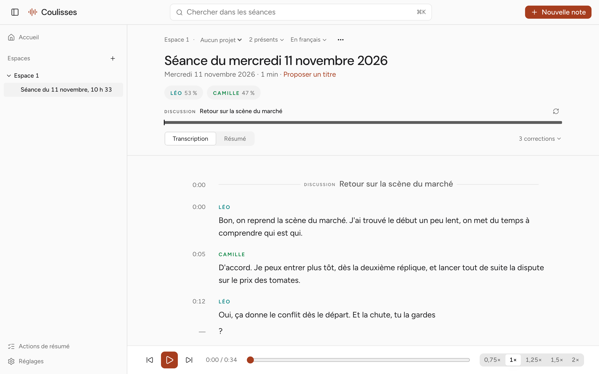
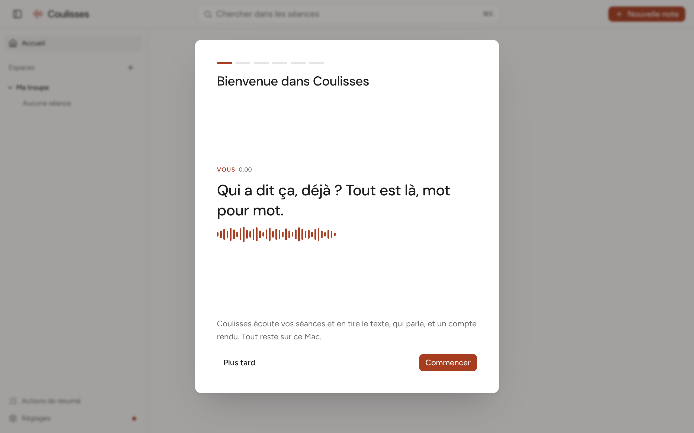

# Coulisses

**Enregistrez une répétition ou une réunion. Coulisses vous dit qui a dit quoi, mot pour mot, et en tire un compte rendu.** Tout se passe sur votre Mac : rien n'en sort, pas même le son.



- **Qui parle quand.** Chaque phrase transcrite, attribuée à sa voix et calée sur l'enregistrement, en français, anglais, allemand, espagnol, italien ou portugais.
- **Sur place ou en visio.** Enregistrez avec le micro du Mac et le son de l'ordinateur (Zoom, Teams, Meet…), ou importez un enregistrement existant, audio ou vidéo.
- **Relire et corriger.** Cliquez une phrase pour l'entendre, renommez les voix, corrigez le texte : vos corrections ne se perdent jamais.
- **Titres, chapitres et résumés**, rédigés par un modèle de langage local avec [Ollama](https://ollama.com). C'est facultatif : sans lui, vous avez déjà le texte et qui a dit quoi.
- **Aucun compte à créer.** Ni chez nous, ni ailleurs.

## Installer

Il faut un Mac Apple Silicon, sous macOS 14.4 ou plus récent.

1. Téléchargez le DMG de la [dernière version](https://github.com/Tibserre/coulisses/releases/latest) et glissez Coulisses dans Applications.
2. Au premier lancement, macOS bloque l'app, qui n'est pas notarisée : ouvrez-la par Réglages Système › Confidentialité et sécurité › « Ouvrir quand même ».
3. Coulisses vous guide : il montre ce qu'il faut télécharger pour écouter vos séances (quelques Go, une seule fois), vous choisissez les langues, et il s'en occupe.
4. Les mises à jour arrivent d'elles-mêmes si vous l'acceptez, et ne s'installent jamais sans un clic.

### Si macOS bloque l'ouverture

Sur un Mac géré par une entreprise, macOS peut refuser d'ouvrir Coulisses sans proposer « Ouvrir quand même ». Installez-la alors depuis le Terminal :

```bash
curl -fsSL https://raw.githubusercontent.com/Tibserre/coulisses/main/installer.sh | sh
```

Cette commande contourne Gatekeeper, le contrôle de macOS. Si votre Mac est géré, ce blocage est un choix de son administrateur : vérifiez que vous avez le droit d'installer une app de cette façon.

Le script ([`installer.sh`](installer.sh), à lire avant de le lancer) remplace ce contrôle par le sien. Il télécharge la dernière version confirmée, vérifie que sa signature est intacte et qu'elle vient bien du certificat de Coulisses, et refuse sinon. Cette vérification vaut ce que vaut ce dépôt : le script et l'app viennent tous deux d'ici. Une ancienne Coulisses n'est mise de côté qu'une fois la nouvelle vérifiée : elle part à la Corbeille, ou dans `~/Coulisses/Anciennes versions`. Le script ne demande aucun mot de passe.

Pour une Coulisses déjà installée que macOS refuse d'ouvrir : `xattr -cr /Applications/Coulisses.app`. Celle-ci ne vérifie rien : ne la lancez que sur une app téléchargée depuis cette page.



Les auteurs des modèles utilisés sont cités dans Réglages › Avancé.

## Pour les développeurs

Architecture, lancement depuis les sources, tests, construction de l'app et publication : [`docs/developper.md`](docs/developper.md). Les décisions sont dans [`docs/decisions/`](docs/decisions/README.md).
